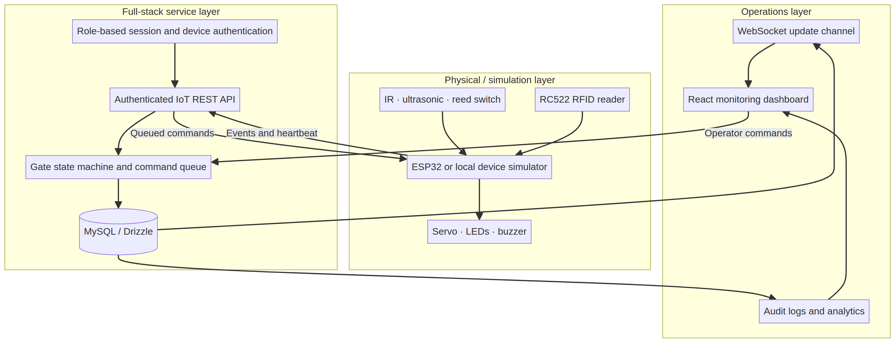
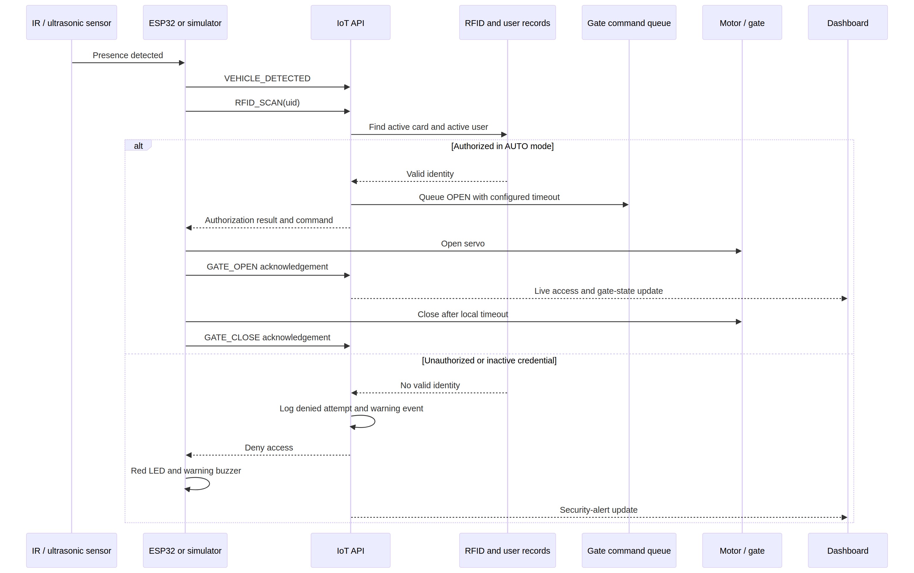
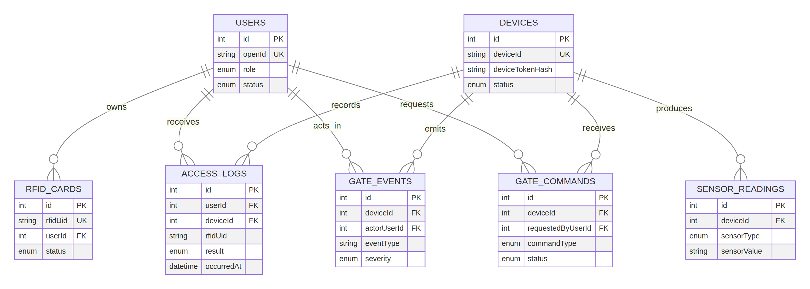

# SMART AUTOMATED GATE CONTROL AND ACCESS MONITORING SYSTEM USING IOT, SENSORS, AND FULL-STACK TECHNOLOGIES

## A PROJECT REPORT

Submitted by

**[CANDIDATE NAME(S)]**

in partial fulfilment of the requirements for the award of the degree of

**BACHELOR OF ENGINEERING / BACHELOR OF TECHNOLOGY**

in

**[BRANCH OF STUDY]**

**KGiSL INSTITUTE OF TECHNOLOGY**  
ANNA UNIVERSITY: CHENNAI 600 025  
**[MONTH AND YEAR]**

> Replace only the bracketed institutional placeholders after confirmation by the candidate, department, and supervisor. The supplied KGiSL format requires Times New Roman, 14-point general text, 1.5 line spacing, A4 printing, and the prescribed binding format. Apply those settings when transferring this source to the final Word document.

---

# BONAFIDE CERTIFICATE

Certified that this project report entitled **“Smart Automated Gate Control and Access Monitoring System Using IoT, Sensors, and Full-Stack Technologies”** is the bonafide work of **[CANDIDATE NAME(S)]**, who carried out the project work under my supervision.

|  |  |
|---|---|
| **[Signature of Head of Department]** | **[Signature of Supervisor]** |
| **[Name of Head of Department]**<br>HEAD OF THE DEPARTMENT<br>[Department]<br>[Full Department and College Address] | **[Name of Supervisor]**<br>SUPERVISOR<br>[Academic Designation]<br>[Department]<br>[Full Department and College Address] |

|  |  |
|---|---|
| INTERNAL EXAMINER | EXTERNAL EXAMINER |

---

# ABSTRACT

This project develops a **Smart Automated Gate Control and Access Monitoring System** that links physical sensing, RFID-based identity checks, backend authorization, device command execution, persistent logging, and web-based supervision. The system is designed around a gate controller represented either by an ESP32 or by a software simulator that follows the same authenticated device protocol. Presence information is received from an infrared or ultrasonic sensor, while an RFID reader provides a credential identifier. The backend verifies the credential against active user and RFID-card records, records the decision, and, in automatic mode, queues a gate-open command carrying a configurable auto-close value. The controller reports gate-open and gate-close position events, allowing the system to maintain an auditable representation of the physical state.

The full-stack implementation includes a MySQL data model, role-aware procedures for Admin, Security Operator, and Registered User roles, a command queue, device heartbeat handling, an authenticated device REST interface, a WebSocket update channel with five-second polling fallback, and a responsive React dashboard. The dashboard provides live gate status, recent access records, security-event panels, manual operator controls, device monitoring, access filtering, identity/RFID management, and analytics. Security events are classified as **INFO**, **WARNING**, or **CRITICAL**. The project deliberately avoids hard-coded device credentials; an administrator rotates a one-time device token that is stored only as a verifier by the server. Automated tests validate core authorization, denial, snapshot, and manual-command workflows. The implementation is demonstrable in simulation mode; all statements about physical performance, electrical operation, and field reliability are explicitly reserved for validation during physical deployment.

---

# TABLE OF CONTENTS

| Section | Title |
|---|---|
| — | Abstract |
| — | List of Tables |
| — | List of Figures |
| — | List of Symbols, Abbreviations and Nomenclature |
| 1 | Introduction |
| 2 | Literature Review |
| 3 | System Analysis and Requirements |
| 4 | System Design |
| 5 | Implementation |
| 6 | Testing and Results |
| 7 | Conclusion and Future Enhancements |
| Appendix A | Device API Contract |
| Appendix B | Hardware Integration and Simulator Guide |
| — | References |

# LIST OF TABLES

| Table No. | Caption |
|---|---|
| Table 1.1 | Project objectives and measurable software outcomes |
| Table 3.1 | Functional requirements |
| Table 3.2 | Non-functional requirements |
| Table 3.3 | Hardware requirements |
| Table 3.4 | Software requirements |
| Table 4.1 | Role and permission model |
| Table 4.2 | Database entities |
| Table 4.3 | Device-event and response policy |
| Table 5.1 | REST device API endpoints |
| Table 6.1 | Executed automated tests |
| Table 6.2 | Physical deployment validation plan |

# LIST OF FIGURES

| Figure No. | Caption |
|---|---|
| Figure 4.1 | Overall system architecture |
| Figure 4.2 | Authorized and denied access event sequence |
| Figure 4.3 | Entity-relationship model |

# LIST OF SYMBOLS, ABBREVIATIONS AND NOMENCLATURE

| Abbreviation | Meaning |
|---|---|
| API | Application Programming Interface |
| ESP32 | Espressif Wi-Fi and Bluetooth system-on-chip family |
| IoT | Internet of Things |
| JWT | JSON Web Token |
| KPI | Key Performance Indicator |
| MFRC522 / RC522 | Contactless RFID reader/controller family |
| RFID | Radio-Frequency Identification |
| REST | Representational State Transfer |
| SPI | Serial Peripheral Interface |
| UID | Unique Identifier |
| WebSocket | Full-duplex browser–server communication protocol |

---

# CHAPTER 1 — INTRODUCTION

## 1.1 General

Gate control is a boundary-security activity in which access decisions, gate movement, physical safety, and record keeping must be coordinated. Manual gates and isolated RFID systems can create operational blind spots because the security operator may not receive a timely view of a denied credential, a gate that remains open, or a controller that stops communicating. The proposed project combines sensing, authorization, command delivery, logging, and visual monitoring in one modular system.

The system uses an ESP32-compatible design because Espressif identifies ESP-IDF as the official development framework for its ESP32 family of system-on-chip devices [1]. The prototype firmware is written in Arduino-compatible C++ for accessibility, while its network behavior follows the same device contract implemented by the local simulator. The RFID design uses the MFRC522 family, a contactless 13.56 MHz reader/writer IC supporting ISO/IEC 14443 A/MIFARE and NTAG communication [2].

## 1.2 Background

An automated gate is not merely an actuator. It is a cyber-physical system with physical inputs, an identity decision, a movement command, and an audit outcome. The project therefore models the gate as a state machine: **CLOSED**, **OPENING**, **OPEN**, **CLOSING**, and **ALERT**. A valid RFID scan in AUTO mode produces a queued OPEN command with the current auto-close setting. Gate position is not assumed from the web screen; it is updated only when the device/simulator reports a corresponding gate event.

## 1.3 Problem Statement

Conventional entry points may rely on manual verification, locally stored credentials, disconnected gate mechanisms, or paper logs. Such arrangements can make it difficult to determine who attempted access, whether an attempt was denied, whether the gate closed, and whether the controller is healthy. The problem addressed by this project is to provide a secure, observable and demonstrable gate-access workflow spanning device input, backend decision-making, database storage and web supervision.

## 1.4 Motivation

The primary motivation is to illustrate an end-to-end engineering workflow rather than a frontend-only dashboard. The project exposes how sensor data travels to an authenticated backend, how a backend command reaches a device, how the device confirms movement, and how the operator sees a resulting audit trail. Security guidance also warns against weak or hard-coded credentials, insecure ecosystem interfaces, insufficient device management, and insecure data handling [4]. These concerns motivate device-token rotation, role-aware procedures, input validation, event logging and heartbeat monitoring.

## 1.5 Objectives

Table 1.1 maps the project objectives to tangible software outcomes.

| Objective | Implemented software outcome |
|---|---|
| Verify an authorized identity | RFID UID is matched to an active card and active registered user. |
| Deny unrecognized access | A denial is logged and a WARNING event is created. |
| Control the gate safely | A backend command queue controls OPEN, CLOSE and AUTO transitions. |
| Avoid a fixed close delay | The auto-close timeout is stored in gate settings and placed in the OPEN command payload. |
| Support monitoring | Dashboard snapshots, WebSocket notifications and polling fallback expose current state. |
| Preserve history | Access logs, gate events and sensor readings are stored in MySQL. |
| Support simulation | A local simulator uses the same `/api/iot/*` endpoints and command acknowledgements as a device. |

## 1.6 Scope

The implemented scope includes software and a hardware reference. The web application manages identities, RFID cards, logs, alerts, device records, configuration and analytics. The device API accepts heartbeat, sensor, RFID, gate-position and command-acknowledgement traffic. The reference ESP32 firmware describes sensor, RC522 RFID, servo, LED and buzzer integration. The scope does **not** claim a completed field installation, production-grade fail-safe certification, biometric identity verification, camera analytics, SMS delivery, or completed hardware measurements.

## 1.7 Proposed Solution

The proposed solution is a modular monolith: React provides the operator interface; Express/tRPC provides the role-aware application backend; MySQL and Drizzle ORM persist state; a REST interface serves external devices; and an authenticated WebSocket endpoint signals live changes. Although the initial project brief suggested FastAPI, the supplied full-stack project environment uses an Express/tRPC architecture. The device-facing REST API remains distinct from the dashboard procedure layer and provides the intended hardware-to-cloud separation.

## 1.8 Advantages

The project centralizes access decisions and logs, separates human and device authentication, makes device state visible, supports secure token rotation, and retains a simulator for demonstrations without physical hardware. Command status is recorded as pending, delivered, acknowledged, failed or expired rather than treating a user-interface click as proof of gate movement.

## 1.9 Organization of the Report

Chapter 2 reviews relevant technologies. Chapter 3 defines requirements and feasibility. Chapter 4 describes architecture, data flow and database design. Chapter 5 discusses implementation. Chapter 6 records executed automated tests and a physical validation plan. Chapter 7 concludes the work and lists future enhancements.

---

# CHAPTER 2 — LITERATURE REVIEW

## 2.1 IoT Controllers and RFID Readers

ESP32-class controllers are appropriate for teaching prototypes because they combine embedded input/output capability with Wi-Fi support and an extensive vendor-supported software ecosystem [1]. The MFRC522 reader supports ISO/IEC 14443 A/MIFARE and NTAG communication at 13.56 MHz, and offers SPI, UART and I²C host interfaces [2]. These characteristics support an architecture in which the RFID reader supplies a UID to the microcontroller and the microcontroller requests a server-side authorization decision.

## 2.2 Web-Based Monitoring

Real-time operational interfaces benefit from a two-way channel. RFC 6455 defines WebSocket as an opening handshake followed by message framing, with browser origin security considerations [3]. The project uses an authenticated `/ws/dashboard` channel to notify the dashboard of events while retaining five-second polling as a resilience fallback. Polling is intentionally preserved so the monitoring view can reconcile with the database after a disrupted live connection.

## 2.3 IoT Security Considerations

The OWASP IoT project identifies weak or hard-coded passwords, insecure network services, insecure ecosystem interfaces, insecure data handling, and weak device management as important classes of risk [4]. The project responds by avoiding source-embedded device credentials, storing only a SHA-256 verifier, validating device identifiers and tokens on device endpoints, protecting management procedures by role, and recording device-communication events. These controls improve the prototype’s security posture but do not replace a full production security assessment.

## 2.4 Research Gap Addressed

Many introductory demonstrations stop at RFID reading and servo motion. This work addresses the engineering gap between that local interaction and a monitored full-stack system. The emphasis is on traceable state changes, role separation, device command acknowledgement, simulation parity, and an explicit distinction between implemented software behavior and physical claims pending deployment validation.

---

# CHAPTER 3 — SYSTEM ANALYSIS AND REQUIREMENTS

## 3.1 Existing System

An existing manual or isolated electronic gate commonly has a local controller, an actuator and a limited record of movement. It may not provide centralized identity management, filtered historical records, device-health signals, or a structured security event model. A purely frontend prototype is also inadequate because its displayed state does not confirm a corresponding device action.

## 3.2 Limitations of Existing System

The main limitations are limited traceability, delayed incident awareness, insufficient centralized access management, absent device-state confirmation and inability to demonstrate hardware-independent integration. In particular, changing a visual indicator in a dashboard does not prove that a physical gate has received or completed a command.

## 3.3 Proposed System

The proposed system accepts device events, validates RFID cards against registered records, creates access logs, enqueues commands, tracks acknowledged execution and exposes operations through a dashboard. Device events are handled by common backend services whether their source is an ESP32 or the local simulator. This common-service design ensures that simulation does not bypass authorization or audit logging.

## 3.4 Functional Requirements

Table 3.1 describes the principal functional requirements.

| ID | Requirement | Acceptance condition |
|---|---|---|
| FR-01 | Role-aware access | Admin, Operator and Registered User roles are stored and checked by protected procedures. |
| FR-02 | RFID verification | Active card plus active user results in authorization; otherwise denial is recorded. |
| FR-03 | Gate control | Admin/Operator can queue OPEN, CLOSE and AUTO actions. |
| FR-04 | Configurable auto-close | Admin changes a persisted 3–300 second timeout; the device receives it in the OPEN command payload. |
| FR-05 | Device API | Heartbeat, events, command polling and acknowledgement endpoints require device credentials. |
| FR-06 | Event detection | Unauthorized credentials, repeated denials, forced-open, offline and command-failure conditions are stored as events. |
| FR-07 | Monitoring | The dashboard shows gate/device status, activity, alerts and data-backed analytics. |
| FR-08 | Simulation | Local simulator uses device REST endpoints and local auto-close behavior. |

## 3.5 Non-functional Requirements

| ID | Requirement | Design response |
|---|---|---|
| NFR-01 | Security | Human procedures are role protected; devices authenticate with an ID/token pair. |
| NFR-02 | Reliability | Command states and acknowledgements avoid assuming execution from a UI request. |
| NFR-03 | Maintainability | Database tables, shared service functions, routers, dashboard pages and device clients are separated. |
| NFR-04 | Usability | A responsive dashboard gives concise live operational information. |
| NFR-05 | Observability | Logs, alerts, heartbeat timestamps and command records are retained. |
| NFR-06 | Demonstrability | Seeded records and a device simulator support an academic demonstration. |

## 3.6 Hardware Requirements

| Component | Purpose | Status in this project |
|---|---|---|
| ESP32 board | Wi-Fi-connected controller | Firmware reference provided; physical deployment pending. |
| MFRC522/RC522 | RFID tag/card reader | Firmware reference provided; physical deployment pending. |
| IR or ultrasonic sensor | Presence detection | Firmware event integration provided; physical deployment pending. |
| Reed switch | Gate-position/forced-open evidence | Firmware reference provided; physical deployment pending. |
| Servo motor | Gate prototype actuator | Firmware reference provided; physical deployment pending. |
| LEDs and buzzer | Local status feedback | Firmware reference provided; physical deployment pending. |

## 3.7 Software Requirements

| Component | Technology |
|---|---|
| Web dashboard | React, TypeScript, Tailwind CSS, Recharts |
| Application backend | Express, tRPC, Zod validation |
| Device API | JSON REST routes under `/api/iot/*` |
| Live updates | WebSocket server with polling fallback |
| Data layer | MySQL/TiDB-compatible database and Drizzle ORM |
| Simulator | Node.js native `fetch` client |
| Firmware | Arduino-compatible C++ with ESP32Servo, MFRC522 and ArduinoJson |
| Test framework | Vitest |

## 3.8 Feasibility Analysis

The project is technically feasible because the chosen elements have clear interface boundaries. The RFID reader communicates with an ESP32 through SPI, the controller communicates with the API through Wi-Fi/HTTPS deployment, and the server persists structured records. Operational feasibility is supported by a dashboard that exposes familiar concepts: status, recent activity, security alerts and command controls. Economic feasibility is appropriate for a prototype because ESP32-class devices and common sensor modules are low-cost relative to industrial gate systems. Safety and electrical feasibility still require physical validation, correctly rated power supplies, mechanical end stops and a manual override before any real gate actuation.

---

# CHAPTER 4 — SYSTEM DESIGN

## 4.1 Overall Architecture

Figure 4.1 shows the primary layers. Sensors and the RFID reader feed an ESP32 or simulator. The device sends authenticated events to the REST API and polls pending commands. The backend applies the state machine and stores records in MySQL. The dashboard receives database-backed snapshots and live notifications.



## 4.2 Hardware Architecture

The hardware reference consists of an ESP32, an RC522 RFID reader, an IR input, a reed-switch input, a servo output, LEDs and a buzzer. The RFID reader is a contactless frontend with SPI capability; correct voltage and wiring conditions must be validated against the module and board documentation before connection [2]. Servo power must be isolated from sensitive logic supply where required by the physical assembly.

## 4.3 Software Architecture

The backend is organized into a schema layer, database helpers, a shared gate service, protected tRPC routers, device REST handlers, and live-update management. The shared gate service makes authorization and event processing independent of the caller. Consequently, a simulator cannot alter dashboard state without first passing through the same persistence and state-transition logic used by the device interface.

## 4.4 Data Flow Diagram

Figure 4.2 shows the access flow. A successful RFID request is not enough to state that the gate is open; the device must subsequently report a gate-position event. A denied scan produces a log and event without creating an open command.



## 4.5 Use Cases

The Admin role manages identities, RFID cards, device tokens and auto-close configuration. The Security Operator monitors live information, views logs and alerts, and queues manual OPEN, CLOSE and AUTO commands. The Registered User is an access identity to which an RFID card may be assigned. The ESP32/simulator submits events, polls commands and acknowledges execution.

## 4.6 Sequence Design

The authorized sequence is: presence detection, RFID scan, device API submission, user/card verification, log insertion, OPEN command queue, device movement, gate-open acknowledgement, local auto-close delay, and gate-close acknowledgement. The unauthorized sequence omits the OPEN command and emits a warning event. The forced-open sequence changes the state to ALERT and creates a critical event.

## 4.7 Database Design

Table 4.2 summarizes the persistent entities.

| Entity | Purpose | Important fields |
|---|---|---|
| `users` | Human identities and roles | `openId`, `role`, `status` |
| `rfid_cards` | Credential assignment and revocation | `rfidUid`, `userId`, `status` |
| `devices` | Controller registry and heartbeat | `deviceId`, `deviceTokenHash`, `status`, `lastSeenAt` |
| `access_logs` | Append-only authorization outcomes | `rfidUid`, `result`, `gateState`, `occurredAt` |
| `gate_events` | Security and operations history | `eventType`, `severity`, `resolved` |
| `sensor_readings` | Device telemetry | `sensorType`, `sensorValue`, `quality` |
| `gate_commands` | Device command life cycle | `commandId`, `commandType`, `status` |
| `gate_settings` | Persisted current state and auto-close policy | `gateMode`, `gateState`, `autoCloseTimeoutSeconds` |

## 4.8 Entity-Relationship Diagram



## 4.9 API Architecture

Dashboard traffic uses protected typed procedures. Device traffic uses REST endpoints so an ESP32 does not need a browser session. Table 5.1 lists the device interface in Chapter 5. Device authentication uses request headers, and the backend compares a hash of the supplied token against a stored verifier. The token is generated only when an administrator rotates it.

## 4.10 Security Architecture

Table 4.3 relates important events to policy.

| Event | Severity | Response |
|---|---|---|
| Unknown or inactive RFID | WARNING | Log denied attempt; do not queue OPEN; publish dashboard update. |
| Repeated denied RFID scans | CRITICAL | Create repeated-attempt event after the configured rule detects three denials in five minutes. |
| Forced gate open | CRITICAL | Set gate state to ALERT and suspend automatic opening. |
| Device offline | WARNING | Update device status and create communication-failure event. |
| Command failure | WARNING | Mark command failed and record event. |
| Manual operation | INFO | Queue the command with authenticated actor identity and create an audit event. |

---

# CHAPTER 5 — IMPLEMENTATION

## 5.1 ESP32 Firmware

The firmware reference in `firmware/gate_controller.ino` initializes Wi-Fi, SPI, RFID reader, servo, indicators and REST calls. It publishes `VEHICLE_DETECTED`, `RFID_SCAN`, `GATE_OPEN`, `GATE_CLOSE` and `FORCED_GATE_OPEN` events. It polls device commands and parses `autoCloseTimeoutSeconds` from the OPEN command payload, so the close delay is supplied by backend configuration rather than compiled as a fixed constant.

## 5.2 RFID Module and Sensor Module

The RFID code reads a UID from the RC522 and submits it to the API. The IR sensor creates a presence event; a reed switch is reserved for position consistency and forced-open detection. The NXP MFRC522 documentation describes a 13.56 MHz contactless reader/writer design and host interfaces including SPI, which supports this reference wiring approach [2]. UID-only access is suitable for a prototype but should be combined with stronger credential protections and threat modeling for a higher-security deployment.

## 5.3 Servo Gate Controller

The backend queues gate commands, while the device controls the servo and reports movement. The gate state changes to OPEN only after the device sends a `GATE_OPEN` event. Similarly, it changes to CLOSED only after the device reports `GATE_CLOSE`. This distinction prevents the dashboard from treating intent as a completed physical action.

## 5.4 Backend, Database and Authentication

The database schema uses normalized tables, foreign keys and time-oriented indexes for event and log retrieval. A platform-backed session is used for human users, while tRPC middleware enforces Admin or Admin/Operator procedures. Device clients use `x-device-id` and `x-device-token` headers. The server stores a SHA-256 verifier rather than the raw generated token. Input is validated with Zod schemas before device events and management actions are processed.

## 5.5 Real-Time Dashboard and Analytics

The dashboard uses an authenticated WebSocket upgrade endpoint to publish change notices. RFC 6455 describes WebSocket’s bidirectional communication model and browser-origin security relevance [3]. To retain a usable monitoring screen if that channel is unavailable, the dashboard also refetches its database snapshot every five seconds. Recharts renders daily access counts, authorization outcome mix, hourly traffic, security-event mix and current stored gate-open duration.

## 5.6 Alert System and Simulation Mode

The shared service creates `gate_events` with INFO, WARNING or CRITICAL severity. The browser simulator console provides repeatable scenario controls; the local Node.js simulator is the more faithful device demonstration because it uses the REST endpoints, polls commands, sends acknowledgements, and performs auto-close locally. Therefore the dashboard does not need to distinguish simulator data from ESP32 data.

## 5.7 Device API Endpoints

| Table 5.1: Endpoint | Method | Purpose |
|---|---|---|
| `/api/iot/heartbeat` | POST | Validates device credentials and records online status. |
| `/api/iot/events` | POST | Accepts sensor, RFID, position and security events. |
| `/api/iot/commands` | GET | Returns pending commands for the authenticated device and marks delivery. |
| `/api/iot/commands/:commandId/ack` | POST | Records successful or failed command completion. |

---

# CHAPTER 6 — TESTING AND RESULTS

## 6.1 Testing Methodology

Testing was separated into backend unit/integration behavior, interface verification, device API contract checks and a future physical-validation plan. The implemented automated tests call the real gate service against the configured project database. The dashboard was visually inspected after its live query resolved, confirming presentation of populated metrics, a gate panel, manual controls, access rows and alerts.

## 6.2 Executed Automated Tests

The final executed test run completed on **19 August 2026**. Vitest reported **eleven passing tests across three files** in approximately **23.87 seconds** in the sandbox environment. This duration is a test-run observation, not a claim of production gate response time.

| Table 6.1: Test Case ID | Test scenario | Expected result | Observed result | Status |
|---|---|---|---|---|
| TC-01 | Session logout | Session cookie is cleared and success is returned. | Existing template authentication test passed. | PASS |
| TC-02 | Registered RFID scan | An active card authorizes and queues OPEN in AUTO mode. | Authorization true; OPEN command returned. | PASS |
| TC-03 | Unknown RFID scan | Access is denied and no OPEN command is created. | Authorization false; command null. | PASS |
| TC-04 | Dashboard snapshot | Seeded device, settings and recent access rows are returned. | Snapshot contained simulator device, timeout and records. | PASS |
| TC-05 | Manual close command | An administrator request queues CLOSE in manual-closed mode. | CLOSE command and expected mode returned. | PASS |
| TC-06 | Forced-open event | A forced-open report changes the stored gate state to ALERT. | Dashboard snapshot reported ALERT. | PASS |
| TC-07 | Device-token rotation | Only a newly rotated token validates for the registered device. | Current token accepted; incorrect token rejected. | PASS |
| TC-08 | Registered User role | Registered User cannot issue a manual OPEN command. | Protected procedure returned FORBIDDEN. | PASS |
| TC-09 | Operator role | Security Operator cannot change Admin-only auto-close settings. | Protected procedure returned FORBIDDEN. | PASS |
| TC-10 | Administrator user CRUD | Admin creates, reads, updates and removes a managed identity. | Created record was returned, updated and removed successfully. | PASS |
| TC-11 | Simulator workflow | Unauthorized simulator scenario records a denied RFID attempt through the shared service. | Scenario completed and the denied record appeared in the snapshot. | PASS |

## 6.3 Integration and System Testing

The device API was exercised with a valid simulator device identifier and token before source credential removal was completed, confirming a successful HTTP response path. The final design replaces that fixed development credential with administrator-controlled rotation. The command-centre dashboard was captured with populated stored data after its initial database query completed. The implementation also provides scenarios for authorized access, unauthorized access, forced gate open, device offline and command polling.

## 6.4 Results and Interpretation

The current evidence supports the following conclusion: the software system can persist authorization outcomes, issue and record commands, reflect device events, display stored operational data and run core service tests in simulation. It does **not** establish physical gate speed, RFID reading distance, Wi-Fi coverage, servo load capability, sensor accuracy, electrical safety, emergency override performance or real-world security resistance.

## 6.5 Physical Hardware Validation Plan

| Table 6.2: Test ID | Physical validation scenario | Evidence to collect | Current status |
|---|---|---|---|
| HV-01 | RC522 card read at operating distance | UID read logs; tested distance; repeated trial counts | To be validated during physical deployment. |
| HV-02 | Presence sensor detection | Sensor state and environmental test notes | To be validated during physical deployment. |
| HV-03 | Servo open/close with prototype mechanism | Travel observations, power measurements, obstruction response | To be validated during physical deployment. |
| HV-04 | Reed-switch gate position | Reported versus observed position records | To be validated during physical deployment. |
| HV-05 | Network recovery | Device heartbeat and retry records after Wi-Fi interruption | To be validated during physical deployment. |
| HV-06 | Manual safety override | Documented operator procedure and safe actuation outcome | To be validated during physical deployment. |

---

# CHAPTER 7 — CONCLUSION AND FUTURE ENHANCEMENTS

## 7.1 Conclusion

This project delivers a full-stack, simulation-capable smart-gate system rather than a static dashboard. It combines role-aware human access, device-specific authentication, RFID authorization, persisted configuration, gate command queueing, device acknowledgements, alerts, monitoring, analytics and documentation. The command flow ensures that an interface request alone is not treated as completed gate movement. The simulator and ESP32 reference follow the same conceptual event and command contract, enabling end-to-end software demonstration without a physical prototype.

## 7.2 Contributions

The primary contributions are the normalized access-control data model, configurable auto-close policy, explicit gate state machine, device REST API, WebSocket/polling monitoring design, secure device-token rotation, responsive operations dashboard, local simulator, ESP32 reference, automated test cases and KGiSL-aligned report source.

## 7.3 Limitations

The current work is a prototype. The API and dashboard do not replace a safety-certified industrial gate controller. The reference firmware must be electrically and mechanically tested before use. The physical behavior of RFID readers, sensors, power supplies, servos and network links is not measured in this report. HTTPS transport, production secrets management, device provisioning, certificate management, firmware signing, camera integration, intrusion-resistant enclosures and formal security testing require additional deployment work.

## 7.4 Future Enhancements

Future work may add camera-supported face or number-plate verification, mobile alerts, secure remote update mechanisms, multi-gate tenancy, encrypted device certificates, camera-assisted incident evidence, edge anomaly detection, cloud reporting and formal safety controls. These are **future enhancements**, not features claimed as implemented by this project.

---

# APPENDIX A — DEVICE API CONTRACT

All device calls require `x-device-id` and `x-device-token` headers. The device token is generated in the Admin Gate Device screen and should be placed in local firmware or simulator configuration, never in a repository.

```json
POST /api/iot/events
{
  "eventType": "RFID_SCAN",
  "rfidUid": "RFID-ALPHA-001"
}
```

The permitted event vocabulary is `RFID_SCAN`, `AUTHORIZED_ACCESS`, `UNAUTHORIZED_ACCESS`, `VEHICLE_DETECTED`, `GATE_OPEN`, `GATE_CLOSE`, `FORCED_GATE_OPEN`, `DEVICE_ONLINE`, and `DEVICE_OFFLINE`. The backend may also create derived events such as `UNAUTHORIZED_RFID`, `REPEATED_UNAUTHORIZED_ACCESS`, `COMMUNICATION_FAILURE` and `COMMAND_FAILURE`.

# APPENDIX B — HARDWARE INTEGRATION AND SIMULATOR GUIDE

For local simulation, an administrator rotates the simulator token in the dashboard, then exports it in the terminal before running `node simulator/gate-device-simulator.mjs authorized`. The simulator submits events to `/api/iot/*`, reads its command queue and reports actuator state. For physical integration, copy `firmware/config.example.h` to `firmware/config.h`, set deployment values, install ESP32Servo, MFRC522 and ArduinoJson, confirm wiring, and upload `firmware/gate_controller.ino`. Do not commit `config.h`.

# REFERENCES

[1] Espressif Systems, “ESP-IDF Programming Guide,” *Espressif Documentation*. Available: <https://docs.espressif.com/projects/esp-idf/en/latest/esp32/>. Accessed: 19 August 2026.

[2] NXP Semiconductors, “MFRC522: Standard performance MIFARE and NTAG frontend,” *Product Data Sheet*, Rev. 3.9, 27 April 2016. Available: <https://www.nxp.com/docs/en/data-sheet/MFRC522.pdf>. Accessed: 19 August 2026.

[3] I. Fette and A. Melnikov, “The WebSocket Protocol,” *RFC 6455*, Internet Engineering Task Force, December 2011. Available: <https://www.rfc-editor.org/rfc/rfc6455>. Accessed: 19 August 2026.

[4] OWASP Foundation, “OWASP Internet of Things,” *OWASP*. Available: <https://owasp.org/www-project-internet-of-things/>. Accessed: 19 August 2026.
